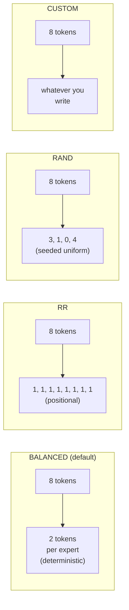

# MoE expert routing

For Mixture-of-Experts models, every token visiting an MoE layer
needs an answer to two questions: **which experts do I activate** and
**which EP rank holds them**. The first is the model's gate
function; the second is determined by how the simulator assigns
experts to ranks. This page is about both.

> Configuration angle (`--expert-routing-policy` flag, when to use
> which) is on **[Examples → Expert parallel](/docs/examples/parallelism/expert-parallel)**.
> This page is the internal mechanics.

## The piece that does it: `GateRouter`

`serving/core/gate_function.py` defines `GateRouter`. The trace
generator instantiates one per simulation; on every MoE block it
calls:

```python
GateRouter(
    num_local_experts=N,           # total experts in the model
    num_experts_per_token=K,       # top-K activations per token
    routing_policy='BALANCED',     # one of 4 policies, see below
    seed=42,
    block_copy=True,
)

result = router.route(num_tokens=T, tp_rank=r, num_experts_per_token=K)
# → RoutingResult(local_tokens=[...], activated_experts=[...], source_tokens=[...])
```

`local_tokens[i]` is the number of tokens assigned to EP rank `i`
after dispatch. `activated_experts[i]` is the count of distinct
experts touched on that rank. Both feed into the per-rank attention/MLP
latency lookup.

## Four policies



| Policy | Determinism | What it models | When to use |
| --- | --- | --- | --- |
| **BALANCED** (default) | Deterministic | Idealized load-balanced gate (post-aux-loss training) | Most research baselines |
| **RR** | Deterministic | Pure round-robin assignment | Sanity / null-baseline runs |
| **RAND** | Seeded random | Uniform random per token | Worst-case load imbalance studies |
| **CUSTOM** | Plug-in | Whatever you write | Real trained gate weights, ablation |

### BALANCED, closed-form pigeonhole

BALANCED computes the *exact* token distribution that a perfectly
load-balanced gate would produce: for `T` tokens and `E` experts with
top-`K`, each expert gets `T*K/E` tokens (with the remainder split
deterministically across experts to round to integers).

This is what a model with a well-trained auxiliary load-balancing
loss converges to in expectation. It's the simulator's default
because:

1. Real production MoE deployments use auxiliary losses → balanced
   distribution is the realistic baseline.
2. It's deterministic, so simulations are reproducible.
3. It enables the **block copy** optimization (see below).

### RR, round-robin

Token *t* goes to expert `t % num_local_experts`. Same expert each
forward, regardless of token content. Useful as a sanity check or
when you want a "no smart routing" baseline; produces identical
per-rank token counts to BALANCED in expectation.

### RAND, random

Per-token uniform random across experts (using `seed=42` by default
for reproducibility). Produces realistic worst-case load imbalance
- some ranks see more tokens than others, which is what an
*untrained* gate produces. Use this if you want to study the cost of
load imbalance specifically.

### CUSTOM, plug-in

Edit `gate_function.py::GateRouter._custom_routing`. The hook
receives the token list and returns expert assignments per token.
Use this if you want to drive routing from real trained gate weights
or a learned-from-trace model.

## Expert-to-rank assignment

Whatever policy decides "token T goes to expert E", the simulator
also has to know "expert E lives on which rank". This uses **even
partitioning**:

```
GateFunction.expert_owner(e, ep_size, num_experts)
    = min(e * ep_size // num_experts, ep_size - 1)
```

So with 128 experts and `ep_size=2`, experts 0–63 live on rank 0 and
64–127 on rank 1. With `ep_size=4`, each rank holds 32 experts. The
`min(..., ep_size - 1)` is defensive — for a valid expert id the
division already lands below `ep_size` — but it keeps an out-of-range id
from indexing past the last rank.

The `GateRouter.route()` output collapses per-token assignments into
per-rank token counts that ASTRA-Sim consumes through the trace's
`EXPERT {i}` markers.

## `block_copy`: what it means and when it's safe

By default, `block_copy=True`. The trace generator emits the full
trace for **only the first transformer block** and replays it
across all blocks via a single `block_copy` Chakra instruction.

This is **safe** for:

- Dense models (no MoE, all blocks identical).
- MoE with `BALANCED` (every block routes the same way, since
  BALANCED is deterministic and stateless).

It's an **approximation** for:

- MoE with `RR` (alternating round-robin position differs per layer,
  in practice the per-rank counts are still nearly identical).
- MoE with `RAND` (per-block randomness produces variance the copy
  can't capture).
- MoE with `CUSTOM` (depends entirely on what you wrote).

For research where per-block variance matters, set
`enable_block_copy=False` in the trace generator (or pick a policy
where block_copy is auto-disabled). Simulation runs more slowly but
generates per-block traces.

## Per-rank latency lookup

Every rank's MoE block latency comes from
`profiler/perf/<hw>/<model>/<variant>/tp1/moe.csv` keyed on:

| Key | Meaning |
| --- | --- |
| `local_tokens` | Tokens assigned to this rank after dispatch |
| `activated_experts` | Number of *distinct* experts this rank touches |

Profiled at TP=1 (no tensor splitting in MoE, per-expert weights are
already small). Simulator does 2D linear interpolation across the
two axes.

The full MoE block latency is then **max(rank_latencies)** because
ranks execute in parallel and synchronize at the ALLTOALL barrier.
Whichever rank gets the most tokens × experts dominates.

## What ALLTOALL costs surround the MoE block

Each MoE block in the trace is sandwiched between two
ALLTOALL collectives:

```
input_residue → dispatch ALLTOALL → expert compute → combine ALLTOALL → output_residue
```

- **Dispatch ALLTOALL**: routes input activations from each rank's
  TP shard to the rank holding their assigned expert.
- **Combine ALLTOALL**: gathers expert outputs back to the
  originating ranks.

Both have `comm_size = total_len * hidden_size * fp_size` (full
activation tensor; ASTRA-Sim divides per rank).

For **DP+EP** topologies, the `comm_size` is synchronized to the max
across the DP group, see
**[Parallelism mechanics](./parallelism-mechanics)**.

## Gotchas

1. **`block_copy` defaults to True** and silently produces an
   approximation for non-BALANCED policies. If you're studying load
   imbalance specifically, disable it.
2. **`activated_experts` is per-rank, not per-token.** A rank with
   100 tokens hitting 8 distinct experts reports `activated_experts
   = 8`, not 800. The latency lookup expects this convention.
3. **MoE is profiled at TP=1.** Increasing `tp_size` doesn't change
   the MoE CSV path. Splitting expert weights happens via `ep_size`,
   which the simulator handles by adjusting the rank-to-expert
   mapping, not by re-profiling.
4. **`num_experts_per_tok` (top-K)** is read from the model's HF
   config. Deviating from the trained value is OK at simulation time
   but won't match the real model's behavior.
5. **Dummy batches in DP groups still route through the gate.**
   1-token dummy batches go through routing exactly like real
   batches, so DP+EP results are consistent across waves.

## Recorded decode replay

`--expert-routing-policy TRACE` binds serving requests to an external read-only
TracePack. Prepare disjoint calibration and evaluation requests with
`python -m workloads.generators moe-trace --help`, then supply its JSONL,
`--expert-trace-pack`, and `--expert-policy-config` to `python -m serving`.
Configurations and policies live in `configs/cluster/pim_experiments/expert_replay/`
and `configs/expert_replay/`.

```bash
python -m workloads.generators moe-trace \
  --trace-pack ../trace_packs/full/qwen3_235b_a22b_fp8/mmlu \
  --output workloads/moe_replay/mmlu.jsonl \
  --calibration-output workloads/moe_replay/calibration.json

python -m serving \
  --cluster-config configs/cluster/pim_experiments/expert_replay/qwen3_235b_h200_8x16.json \
  --expert-routing-policy TRACE \
  --expert-trace-pack ../trace_packs/full/qwen3_235b_a22b_fp8/mmlu \
  --expert-policy-config configs/expert_replay/adaptive.json \
  --dataset workloads/moe_replay/mmlu.jsonl \
  --output outputs/moe_replay/sim.csv
```

Use `qwen3_235b_h200_1x16.json` for one directly attached CPU/PIM group, or
`qwen3_235b_h200_8x16.json` for eight network-attached groups. Use the explicit configuration matching your GPU and PIM layout.

### Requests and recorded routes

Immutable scheduled token ranges index routes by recorded request, absolute token
position, and layer. Rebuilding a graph does not consume routes. Recomputed
generated tokens reuse their recorded selections. Prompt tokens, including
recomputed prompt tokens, use a labeled balanced approximation. The prefill
instance retains all GPU experts and uses no PIM expert execution; its timing
path is unchanged. D recorded decode forwards correspond to D+1 output tokens;
D=0 finishes after prefill without a KV handoff.

The replay driver accepts one prefill instance and either one decode instance
or two decode instances sharing a DP/EP group, with PP=1. The example
`qwen3_235b_h200_8x16.json` uses TP4 prefill and two TP4 decode instances sharing
EP8; `qwen3_235b_h200_4p4d_8x16.json` uses a single TP4/EP4 decode instance.
A blocking KV handoff reserves destination capacity first, retains
source KV until delivery, and waits when destination capacity is unavailable.
Transfer/control completions never generate tokens. Group replay polls backend
work at the current event time, without the idle 1 ms polling quantum. Handoff
still uses a conservative GPU barrier, rather than a fully asynchronous KV
connector.

One immutable decode plan covers all real decode batches. Padding and dummy members
create no expert demand. For network attachment, communication is derived from
actual selected experts and their assigned GPU ranks or CPU/PIM groups, rather
than from padded source buffers. Transfers use FP8 hidden vectors only; router
logits and expert-ID metadata are not added to the payload. Direct attachment
retains the previous padded GPU AllGather/ReduceScatter convention and its
hidden-plus-router-logit dispatch layout. Other simulator modes are unchanged.

### Residency and physical placement

The original policy equations are reused, with attribution and parity fixtures in
`serving/core/moe_policy/`. Calibration precedes measured serving. Static placement
and adaptive extra-copy placement are fixed after calibration. Adaptive means
calibration-derived residency and per-forward GPU/PIM choice for BOTH experts;
migration is disabled in these fixed-placement policies. The migration preset enables anchored frequency hysteresis. Predictor history updates once the whole
decode group finishes. Current routes feed the residency-aware scheduler; no
expert executes on a device without its weight copy.
For CPU/PIM group replay, the existing `adaptive_extra_budget` placement and its
per-forward scheduler use the measured GPU MoE CSV. There is no additional mode.
Each GPU is queried once for its distinct token instances and active resident
experts, using the same interpolation as execution. Empty ranks cost zero. PIM
costs use the analytical equation separately per physical group. Candidate splits
minimize the maximum GPU/PIM expert compute time; actual activation payload
breaks ties. Communication latency is still charged by ASTRA rather than predicted
by this compute objective.

Calibration retains token-level expert routes. It evaluates hotness-based seeds,
then uses bounded forced-GPU/forced-PIM regret refinement with the configured
extra-copy budget. Each proposed residency rebuilds the hotness-sorted physical
round-robin maps before evaluation, and the complete proposal is re-scheduled
and capacity-checked. At most four refinement passes are attempted, retaining the
best feasible calibration score. Runtime evaluates every count-sorted BOTH-prefix
split and up to two deterministic passes of individual expert switches. This is
a heuristic, not an exact global optimum. Existing histogram predictors and
portable report-equation fixtures remain independent of the serving CSV adapter.

Calibration uses its disjoint recorded requests, with source tokens distributed
evenly over decode instances and TP ranks for the payload tie-break.
`calibration_batch_size` caps the active learning batch independently of the
learning pool size. The pool is consumed in disjoint sequential cohorts; each
request contributes up to `warmup_steps` recorded decode positions. A larger pool
therefore provides more observations without increasing the active batch. When
the cap is omitted, existing configurations retain the single-cohort behavior.
The comparison runner matches this cap to the total decode sequence cap.
The original aggregate equations
remain in the non-group replay path and static policy; adaptive group replay
does not fall back to GPU bandwidth when profile data is unavailable.

For each layer, sort by calibration hotness, breaking ties by expert ID. Assign
GPU-resident experts round robin across decode GPUs, and independently assign
PIM-resident experts round robin across PIM groups. BOTH has one copy in each
domain. Retained copies keep their owners; migration refills only vacated slots. Experts are TP-sharded across packages inside a
PIM group, rather than owned by individual channels. The placement CSV records
hotness, residency, GPU EP rank, and PIM group.

Decode weight reservations include every resident copy. Each instance's shared KV
pool uses its most constrained GPU rank. A PIM group checks both aggregate
capacity and per-package TP-shard capacity. Active KV blocks are never moved by
residency accounting. Eight groups have eight times the one-group PIM capacity.

### Activation traffic and execution order

Decode communication uses simple FP8: one byte per element. A Qwen hidden vector
has 4096 bytes. No scales, routing metadata, quantization, or conversion costs are
charged. Distinct token instances remain distinct across requests, even if their
token IDs or activation values match.

Each token sends one vector per destination PIM group and receives one locally
aggregated result from that group. Two experts in the same group create two
computations but one input/output pair. Two destination groups create two such
pairs. GPU plus PIM expert-pair counts must equal recorded top-k demand.
One returned vector assumes the CPU applies gate weights and sums its local
expert outputs. Numerical tensors, this reduction arithmetic, and gate-weight
metadata are not simulated.

| Attachment | Per-layer sequence |
| --- | --- |
| Direct CPU/PIM | GPU dispatch finishes; GPU expert work overlaps input transfer → group execution → output transfer; join before GPU combine. |
| Network CPU/PIM | Gather source tokens inside each GPU domain → common domain dispatch → local GPU expert dispatch → parallel GPU/PIM execution → local GPU contribution reduction → common domain combine → return combined vectors to source GPUs. |

Direct attachment aggregates traffic on `expert_offload.activation_transfer`,
using separate directional bandwidths and fixed transfer latencies. It keeps the
existing transfer-row backend path.

Network attachment uses hierarchical, placement-aware **direct all-to-all-v**.
The first GPU of each decode TP domain is its network leader. GPU leaders and
CPU/PIM endpoints share one outer communicator, with exactly the same native
exchange algorithm for both types of domain. Prefill GPUs do not participate.
Local exchanges use each decode instance's TP communicator. The old complete
EP8 gather/scatter and separate PIM SEND/RECV branch are absent from this path.
Existing dense-layer TP ring collectives remain unchanged.

A token crosses the scale-out network once per remote domain containing any of
its selected experts. Multiple experts in one domain share the vector; selecting
experts in several domains requires several deliveries. Each destination reduces
its local expert contributions before returning one vector to the source domain.
GPU-domain reductions and CPU reductions are logical operations: their arithmetic
and packing/reordering costs are unmodeled. An input already present at a GPU is
retained instead of retransmitted to that GPU during local dispatch.

Every exchange is an actual Chakra `COMM_COLL_NODE` with `ALL_TO_ALL` type,
communicator ID, collective ID, and per-peer send/receive byte vectors. ASTRA
validates matching vectors, waits for communicator members, sends nonempty peer
messages through the configured analytical network, and completes the collective
only after all messages arrive. Zero-payload members participate in the barrier
without phantom transfers. The direct algorithm has concurrent peer exchanges;
it is not a dense padded ring. Both GPU-only and PIM variants use this algorithm
when run with the network attachment configuration.

With `--save-trace-text`, frontend expert markers describe logical `ALLTOALL`
operations and aggregate dispatch/combine bytes. The saved workload's
`expert_communication.json` expands them into six stages with token-count matrices,
byte totals, and physical domain membership. The `.et` files contain the matching
per-rank executable stages. These files include actual traffic from real tokens,
including zero-byte exchanges, with no dummy-token activation demand.


`network_topology`, `link_bw`, and `link_latency` use the existing per-dimension
vectors: scale-up first, scale-out outermost. An explicit domain map distinguishes
CPU groups from four-GPU domains in ASTRA's rectangular rank container. Cross-domain
GPU collectives and PIM traffic share each domain's directional bandwidth budget.
Within a GPU domain, concurrent local exchanges share each GPU endpoint's
directional link budget. Transmit and receive are independent. The analytical switch has no additional
fabric/bisection contention model beyond these domain budgets. Supplied scale-out
settings are synthetic and independently configurable.

:::caution[Existing backend units]
The analytical network library interprets configured `link_bw` as GiB/s, although
the field is described as GB/s. A configured 400 gives 429.4967296 bytes/ns. This
convention is preserved and effective bandwidth is recorded. Link latency is per
hop: a switch charges two link latencies plus serialization. Direct attachment
uses decimal GB/s.
:::

### Timing, coverage, and limitations

Group execution time is
`ceil(sum_e(ceil(n_e / granularity)) * expert_weight_bytes / group_bandwidth)`
in nanoseconds, for expert token counts `n_e` and bandwidth in bytes/ns.
The supplied configurations use the original analytical equation with sixteen
packages at 0.6 decimal TB/s each and granularity one. Execution counts all expert
pairs, while external activation traffic is deduplicated by group. CPU nonlinear
activation, internal TP communication, utilization losses, and power are not
independently modeled. The bandwidth remains a synthetic assumption.

**TODO: profile rank-local partial-top-k MoE execution**, including additional
low-active-expert points and uneven expert loads. The H200 Qwen table includes
measured single-expert points; intermediate active counts use interpolation. Existing GPU tables execute full top-k work per
queried local token and include inseparable router/combine costs. A token with
two local assignments is still queried against full top-k work; an empty GPU
rank has no MoE lookup. Network PIM dispatch assumes routing is ready with source
activations, without a separately measured gate delay. No pair-ratio correction
is applied to GPU time.

Results quantify actual GPU pairs versus profile-implied top-k pairs, partial
routing, query shapes, extrapolation counts, per-rank GPU work, and per-group PIM
work. These expose the approximation; they are not a measured timing error bound.
Device work sums are utilization inputs, not additive end-to-end latency.

Clusters without `expert_replay` metadata retain legacy channel mapping,
synthetic per-expert PIM CSV timing, wire interpretation, and migration support.
Other routing modes are unchanged.

### Experiments and CPU runtime

Use `python -m serving.replay_experiments --help` for group counts, sequence caps,
normal/pressure memory, saturated/seeded Poisson arrivals, and shortened runs.
Requests and arrivals match across variants; each GPU saturated pilot determines
its Poisson rates. Pressure mode fixes utilization from baseline weights plus a
KV budget of sixteen mean full-request lengths per decode instance, rounded to
blocks, and holds it fixed across policies.

Each per-request CSV has neighboring `.placement.csv` and `.replay.json` files.
They record serving metrics, residency, coverage, resolved configuration/topology,
selected-trace and source/profile hashes, and host timing. CPU wall time,
parent/backend user/system time, calibration/graph time, CPU/host details, and
logging settings remain separate from simulated nanoseconds. Counts distinguish
unique requests, decode rounds, and token forwards: 500 full rounds at cap64 mean
about 32000 token forwards, which can belong to far fewer unique requests.
Calibration CPU time is measured; its serving latency is excluded from evaluation.

Adaptive calibration can reuse an exact-match `calibration_cache_file` across
identical learning configurations. The cache checks route, policy, timing,
geometry, memory, and implementation fingerprints under a process lock. It never
reuses a residency across different learning batch sizes or copy budgets.

The runner enables `prune_completed_graphs` and selects `retain_decode_rounds`.
After every endpoint completes a job, temporary graphs are removed except sampled
decode forwards, the final decode forward, and the first job of each control kind.
Resolved input configurations and retained graph locations remain in the results.
This bounds trace storage during long parallel sweeps without changing execution.

Copy-use counters distinguish residency from execution: a BOTH expert has two
weight copies but executes once per forward. Results count expert-token work on
each copy, switches between successive active uses, and copies never used during
evaluation. Learning statistics record all consumed requests/token positions and
the actual calibration batch-size histogram.

Large TracePacks stay external. Set `EXPERT_TRACE_ROOT` for
`scripts/docker-sim.sh` to mount the archive read-only at `/traces`.

## What's next

- **[Parallelism mechanics](./parallelism-mechanics)**: what the
  ALLTOALLs around the MoE block look like at the network level.
- **[Examples → Expert parallel](/docs/examples/parallelism/expert-parallel)** -
  the configuration angle (when to use which `ep_size`).
- **[Examples → DP+EP MoE](/docs/examples/parallelism/dp-ep-moe)** -
  multi-instance MoE.
