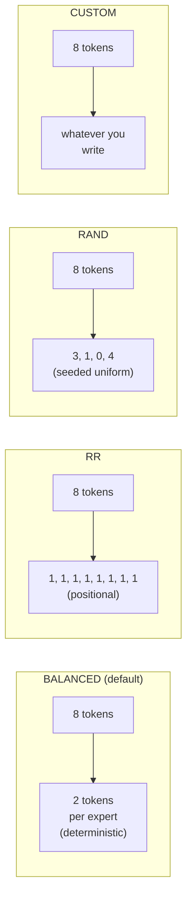

# MoE expert routing

For Mixture-of-Experts models, every token visiting an MoE layer
needs an answer to two questions: **which experts do I activate** and
**which EP rank holds them**. The first is the model's gate
function; the second is determined by how the simulator assigns
experts to ranks. This page is about both.

> Configuration angle (`--expert-routing-policy` flag, when to use
> which) is on **[Examples → Expert parallel](/docs/examples/parallelism/expert-parallel)**.
> This page is the internal mechanics.

## The piece that does it: `GateRouter`

`serving/core/gate_function.py` defines `GateRouter`. The trace
generator instantiates one per simulation; on every MoE block it
calls:

```python
GateRouter(
    num_local_experts=N,           # total experts in the model
    num_experts_per_token=K,       # top-K activations per token
    routing_policy='BALANCED',     # one of 4 policies, see below
    seed=42,
    block_copy=True,
)

result = router.route(num_tokens=T, tp_rank=r, num_experts_per_token=K)
# → RoutingResult(local_tokens=[...], activated_experts=[...], source_tokens=[...])
```

`local_tokens[i]` is the number of tokens assigned to EP rank `i`
after dispatch. `activated_experts[i]` is the count of distinct
experts touched on that rank. Both feed into the per-rank attention/MLP
latency lookup.

## Four policies



| Policy | Determinism | What it models | When to use |
| --- | --- | --- | --- |
| **BALANCED** (default) | Deterministic | Idealized load-balanced gate (post-aux-loss training) | Most research baselines |
| **RR** | Deterministic | Pure round-robin assignment | Sanity / null-baseline runs |
| **RAND** | Seeded random | Uniform random per token | Worst-case load imbalance studies |
| **CUSTOM** | Plug-in | Whatever you write | Real trained gate weights, ablation |

### BALANCED, closed-form pigeonhole

BALANCED computes the *exact* token distribution that a perfectly
load-balanced gate would produce: for `T` tokens and `E` experts with
top-`K`, each expert gets `T*K/E` tokens (with the remainder split
deterministically across experts to round to integers).

This is what a model with a well-trained auxiliary load-balancing
loss converges to in expectation. It's the simulator's default
because:

1. Real production MoE deployments use auxiliary losses → balanced
   distribution is the realistic baseline.
2. It's deterministic, so simulations are reproducible.
3. It enables the **block copy** optimization (see below).

### RR, round-robin

Token *t* goes to expert `t % num_local_experts`. Same expert each
forward, regardless of token content. Useful as a sanity check or
when you want a "no smart routing" baseline; produces identical
per-rank token counts to BALANCED in expectation.

### RAND, random

Per-token uniform random across experts (using `seed=42` by default
for reproducibility). Produces realistic worst-case load imbalance
- some ranks see more tokens than others, which is what an
*untrained* gate produces. Use this if you want to study the cost of
load imbalance specifically.

### CUSTOM, plug-in

Edit `gate_function.py::GateRouter._custom_routing`. The hook
receives the token list and returns expert assignments per token.
Use this if you want to drive routing from real trained gate weights
or a learned-from-trace model.

## Expert-to-rank assignment

Whatever policy decides "token T goes to expert E", the simulator
also has to know "expert E lives on which rank". This uses **even
partitioning**:

```
GateFunction.expert_owner(e, ep_size, num_experts)
    = min(e * ep_size // num_experts, ep_size - 1)
```

So with 128 experts and `ep_size=2`, experts 0–63 live on rank 0 and
64–127 on rank 1. With `ep_size=4`, each rank holds 32 experts. The
`min(..., ep_size - 1)` is defensive — for a valid expert id the
division already lands below `ep_size` — but it keeps an out-of-range id
from indexing past the last rank.

The `GateRouter.route()` output collapses per-token assignments into
per-rank token counts that ASTRA-Sim consumes through the trace's
`EXPERT {i}` markers.

## `block_copy`: what it means and when it's safe

By default, `block_copy=True`. The trace generator emits the full
trace for **only the first transformer block** and replays it
across all blocks via a single `block_copy` Chakra instruction.

This is **safe** for:

- Dense models (no MoE, all blocks identical).
- MoE with `BALANCED` (every block routes the same way, since
  BALANCED is deterministic and stateless).

It's an **approximation** for:

- MoE with `RR` (alternating round-robin position differs per layer,
  in practice the per-rank counts are still nearly identical).
- MoE with `RAND` (per-block randomness produces variance the copy
  can't capture).
- MoE with `CUSTOM` (depends entirely on what you wrote).

For research where per-block variance matters, set
`enable_block_copy=False` in the trace generator (or pick a policy
where block_copy is auto-disabled). Simulation runs more slowly but
generates per-block traces.

## Per-rank latency lookup

Every rank's MoE block latency comes from
`profiler/perf/<hw>/<model>/<variant>/tp1/moe.csv` keyed on:

| Key | Meaning |
| --- | --- |
| `local_tokens` | Tokens assigned to this rank after dispatch |
| `activated_experts` | Number of *distinct* experts this rank touches |

Profiled at TP=1 (no tensor splitting in MoE, per-expert weights are
already small). Simulator does 2D linear interpolation across the
two axes.

The full MoE block latency is then **max(rank_latencies)** because
ranks execute in parallel and synchronize at the ALLTOALL barrier.
Whichever rank gets the most tokens × experts dominates.

## What ALLTOALL costs surround the MoE block

Each MoE block in the trace is sandwiched between two
ALLTOALL collectives:

```
input_residue → dispatch ALLTOALL → expert compute → combine ALLTOALL → output_residue
```

- **Dispatch ALLTOALL**: routes input activations from each rank's
  TP shard to the rank holding their assigned expert.
- **Combine ALLTOALL**: gathers expert outputs back to the
  originating ranks.

Both have `comm_size = total_len * hidden_size * fp_size` (full
activation tensor; ASTRA-Sim divides per rank).

For **DP+EP** topologies, the `comm_size` is synchronized to the max
across the DP group, see
**[Parallelism mechanics](./parallelism-mechanics)**.

## Gotchas

1. **`block_copy` defaults to True** and silently produces an
   approximation for non-BALANCED policies. If you're studying load
   imbalance specifically, disable it.
2. **`activated_experts` is per-rank, not per-token.** A rank with
   100 tokens hitting 8 distinct experts reports `activated_experts
   = 8`, not 800. The latency lookup expects this convention.
3. **MoE is profiled at TP=1.** Increasing `tp_size` doesn't change
   the MoE CSV path. Splitting expert weights happens via `ep_size`,
   which the simulator handles by adjusting the rank-to-expert
   mapping, not by re-profiling.
4. **`num_experts_per_tok` (top-K)** is read from the model's HF
   config. Deviating from the trained value is OK at simulation time
   but won't match the real model's behavior.
5. **Dummy batches in DP groups still route through the gate.**
   1-token dummy batches go through routing exactly like real
   batches, so DP+EP results are consistent across waves.

## Recorded decode replay

`--expert-routing-policy TRACE` connects a recorded TracePack to the complete
serving model. Prepare disjoint calibration and serving requests with
`python -m workloads.generators moe-trace --help`, then pass the generated
JSONL, `--expert-trace-pack`, and `--expert-policy-config` to `python -m serving`.
The example cluster and policy configurations are under
`configs/cluster/pim_experiments/expert_replay/` and `configs/expert_replay/`.

```bash
python -m workloads.generators moe-trace \
  --trace-pack ../trace_packs/full/qwen3_235b_a22b_fp8/mmlu \
  --output workloads/moe_replay/mmlu.jsonl \
  --calibration-output workloads/moe_replay/calibration.json

python -m serving \
  --cluster-config configs/cluster/pim_experiments/expert_replay/qwen3_235b_h200.json \
  --expert-routing-policy TRACE \
  --expert-trace-pack ../trace_packs/full/qwen3_235b_a22b_fp8/mmlu \
  --expert-policy-config configs/expert_replay/adaptive.json \
  --dataset workloads/moe_replay/mmlu.jsonl \
  --output outputs/moe_replay/sim.csv
```

Replay uses immutable scheduled token ranges. Prompt tokens use a labeled
balanced approximation; generated-token routes come from the recorded request,
decode position, and layer, including when preemption causes recomputation.
Prefill produces the first output token, so a request with no recorded decode
forwards finishes on prefill without a KV handoff.

One policy controller owns each decode EP group. It predicts from completed
history, reserves and executes feasible paired copy migrations, executes the
next group forward, then updates history once. GPU/PIM/BOTH placement reserves
physical weight memory; only the remaining GPU capacity is available to KV.
Migrations that cannot reserve free memory are deferred without displacing live KV.
PIM channel assignments remain fixed for each expert across forwards.

The replay driver uses actual GPU endpoints and blocking KV handoffs after
prefill. Explicit communicator IDs distinguish TP and EP groups. Collective
algorithms remain rings over the configured network. Dummy batches and padded
communication buffers never add recorded expert demand. These semantics are
separate from the legacy P/D and padded MoE paths described above.

Use `python -m serving.replay_experiments --help` for the reproducible comparison
matrix. It prepares the same evaluation requests and arrivals for each variant,
derives arrival rates from a GPU baseline, and supports a separately labeled
memory-pressure budget. The per-request CSV has a neighboring `.replay.json`
with residency, migrations, timing, coverage, and profile provenance.
Set `EXPERT_TRACE_ROOT` when launching `scripts/docker-sim.sh` to mount the
external archive read-only at `/traces`. Pass its container path to the commands above.

### Timing limitations and profiling TODO

The supplied Qwen PIM CSV is synthetic. Replay preserves its current
**per-expert** interpretation: lookup at that expert's token count and the
layer's active PIM expert count, with serialization on shared channels.
Activation transfers and migration copies are charged separately.
Migration copies share the configured external link bandwidth, aggregated per
direction and serialized during the blocking migration phase. The policy's
PIM bandwidth parameter is also an explicit synthetic assumption, not a measured
device specification.

**TODO: profile rank-local partial-top-k MoE execution**, including fewer active
experts than the model's top-k and uneven per-expert token counts. The current
GPU table can map such a query to its lowest measured expert-count row. This
iteration retains that behavior and reports out-of-coverage lookup counts;
exact expert selections do not remove this latency-estimation limitation.

## What's next

- **[Parallelism mechanics](./parallelism-mechanics)**: what the
  ALLTOALLs around the MoE block look like at the network level.
- **[Examples → Expert parallel](/docs/examples/parallelism/expert-parallel)** -
  the configuration angle (when to use which `ep_size`).
- **[Examples → DP+EP MoE](/docs/examples/parallelism/dp-ep-moe)** -
  multi-instance MoE.
